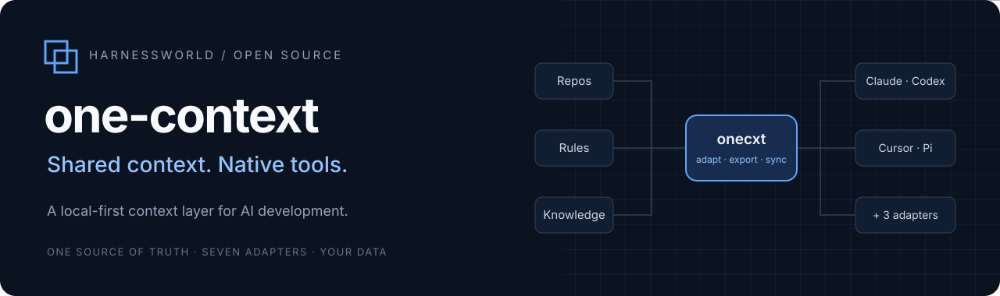
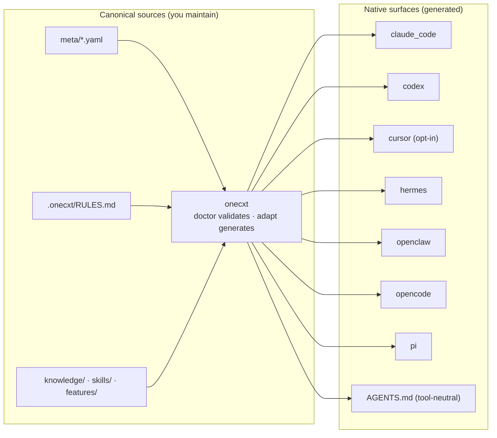

<p align="center">
  
</p>

<div align="center">

# one-context

**Shared context. Native tools.**

One canonical source of truth for your multi-repo AI workspace —
generated into every supported tool's native format.

[`Quickstart`](#quickstart) · [`Architecture`](#how-it-works) · [`Docs`](docs/getting-started.md) · [简体中文](README.zh-CN.md)

[](https://github.com/harnessworld/one-context-opensource/actions/workflows/validate.yml)
[](LICENSE)
[](https://www.python.org/)

`beta` — pre-1.0 · status: [see below](#status)

</div>

---

## What is one-context?

AI coding tools all want project context, but each one invents its own
format: `CLAUDE.md`, `AGENTS.md`, `.cursor/rules/*.mdc`,
`.opencode/instructions/`, `.codex/agents/*.toml`, and so on. Maintaining
the same intent across tools turns into copy-paste drift fast.

**Define your workspace once.** Write repositories, workspaces, agent roles,
behavior profiles, rules, knowledge, and skills in YAML and Markdown.
Then generate each tool’s configuration from the same source:

```bash
onecxt adapt dev
```

- **Shared context** — `meta/*.yaml` manifests plus `.onecxt/RULES.md`,
  `knowledge/`, `skills/`, and `features/` are the only files you
  maintain.
- **Native tools** — adapters translate the shared intent into each
  tool's own surface: instructions, agents, skills, and project files.
- **Guarded output** — generated files carry a marker; `adapt` refuses to
  clobber hand edits, `adapt --check` detects drift, and orphan outputs
  are pruned deterministically.
- **Workspace tooling** — `doctor` validates the whole graph, `sync`
  manages your repository clones, `context export` emits tool-neutral
  bundles, `worktree` drives per-feature branches, and `smart-commit`
  plans multi-repo commits behind explicit safety gates.

## Supported tools (adapters)

`onecxt adapt` auto-discovers **seven** adapters, keyed by:

`claude_code` · `codex` · `cursor` · `hermes` · `openclaw` · `opencode` · `pi`

`cursor` is deliberately **opt-in** (`onecxt adapt dev --only cursor`)
because always-on Cursor rules inflate every chat; all other adapters run
by default. The generation pipeline also emits a shared root `AGENTS.md` for consuming
tools. `adapt-report.json` records the compatibility matrix of each run.

> The adapter layer is beta: tool ecosystems move quickly, so treat
> generated surfaces as build output, regenerate freely, and pin your
> expectations to the [docs](docs/architecture.md) rather than to
> screenshots.

## Quickstart

Runs on a fresh clone — no submodules, no external repositories required.
Needs **Python 3.10+**; see [getting started](docs/getting-started.md) for
the full walk-through (including Windows).

```bash
git clone https://github.com/harnessworld/one-context-opensource.git one-context
cd one-context

# 1. Virtual environment (POSIX shown; Windows: py -m venv .venv + Activate.ps1)
python3 -m venv .venv && source .venv/bin/activate
python -m pip install --upgrade pip

# 2. Install the CLI (editable)
python -m pip install -e "./packages/one-context[dev]"
onecxt --version

# 3. Validate the sample workspace
onecxt doctor

# 4. Generate tool surfaces for six adapters + root AGENTS.md
onecxt adapt dev

# 5. (Optional) Cursor surface, opt-in
onecxt adapt dev --only cursor

# 6. Export a tool-neutral context bundle
onecxt context export dev --format markdown

```

Then make it yours: register your repositories in `meta/repos.yaml`
(`onecxt sync` to clone), drop knowledge into `knowledge/`, copy
`features/_template/` for your first spec, and add skills under
`skills/<name>/SKILL.md`.

## How it works



Rules are inlined eagerly into every target; skills are published lazily
as per-tool stubs pointing back to their canonical `SKILL.md`. See
[`docs/architecture.md`](docs/architecture.md) for the module map and the
full adapter matrix, and [`docs/configuration.md`](docs/configuration.md)
for the main manifest fields.

## Skill evaluation (experimental)

`onecxt eval` regression-tests your skills against a captured known-good
artifact baseline. Three run modes grade with increasing depth:
`quick` (local assertions, no tokens), `probe` (spawn the agent CLI and
verify the skill actually triggers), and `full` (real agent run + LLM
judge on subjective dimensions).

```bash
# Freeze a satisfactory artifact as the baseline
onecxt eval capture --skill my-skill --from features/cat/my-feature --prompt "..."

onecxt eval run my-skill/my-case                # quick (default)
onecxt eval run my-skill/my-case --mode probe   # trigger verification
onecxt eval report my-skill/my-case --format html
```

The agent CLI defaults to `claude`; override the binary with
`ONECXT_EVAL_AGENT_BIN`. Probe and full modes need Anthropic credentials
and degrade to `INSUFFICIENT_EVIDENCE` when they are missing; quick runs
are fully local.

## Repository layout

| Path | Contents | Owner |
|---|---|---|
| `packages/one-context/` | `one_context` package + `onecxt` CLI + tests | framework |
| `meta/` | repos · workspaces · agents · profiles manifests (sample) | you |
| `.onecxt/RULES.md` | single constraint surface, inlined into all tools | you |
| `knowledge/01_Compiled/one-context/` | canonical overview + conventions (sample) | you |
| `skills/workspace-review/` | example read-only skill (sample) | you |
| `features/_template/` + `INDEX.md` | spec-driven change flow (sample) | you |
| `docs/` | getting started · architecture · configuration | framework |
| `docs/assets/` | original vector artwork only; no generated media | framework |

## Ownership boundary and privacy limits

- **Hand-written truth vs. generated build output.** Only the canonical
  sources above are meant to be edited. Anything carrying the
  `GENERATED by onecxt adapt` marker — including `AGENTS.md`, `CLAUDE.md`,
  and the per-tool directories — is regenerated from them. The root
  `AGENTS.md` is tracked as a bootstrap; other tool surfaces are ignored.
- **Your content stays yours.** `knowledge/`, `skills/`, and `features/`
  are ordinary directories of fresh examples; replace or extend them,
  including as your own separate submodules if you prefer — nothing here
  assumes them.
- **Privacy is a filter, not encryption.** Markdown notes with
  `visibility: private` frontmatter are excluded from context exports and
  adapter projections — but they remain readable on disk and in git
  history if committed. Keep genuinely sensitive material out of tracked
  paths.
- **Keep machine settings local.** Per-machine settings
  (`.onecxt/local.yaml`, `.env*`) are git-ignored; shared manifests carry
  no proxy routes, provider endpoints, or personal paths.

## Documentation

- [Getting started](docs/getting-started.md) — clone → install → doctor →
  adapt → export, plus adding your own repos/knowledge/features/skills
- [Architecture](docs/architecture.md) — module map, generation pipeline,
  adapter matrix
- [Configuration](docs/configuration.md) — manifest schemas and generated
  state
- [Changelog](CHANGELOG.md) — Unreleased changes; no releases yet

## Contributing and security

- Please read [CONTRIBUTING.md](CONTRIBUTING.md) — framework-generic
  changes only; private workspaces don't belong here.
- Vulnerabilities: **not** public issues; see
  [SECURITY.md](SECURITY.md).

## Status

- **Beta.** Manifest formats may still change between 0.x versions; the
  [changelog](CHANGELOG.md) documents them.
- CI is configured for Linux, macOS, and Windows on Python 3.12 (plus
  Python 3.10 on Linux) and runs the package tests, `onecxt doctor`,
  `onecxt adapt dev`, and `adapt --check`; consult the badge above for
  the latest run results.
- Core workspace operations run locally. Repository sync uses Git remotes;
  optional skill evaluation (`onecxt eval`) can invoke an agent CLI (default
  `claude`, override via `ONECXT_EVAL_AGENT_BIN`) and a model provider.

## License

MIT — see [LICENSE](LICENSE).
