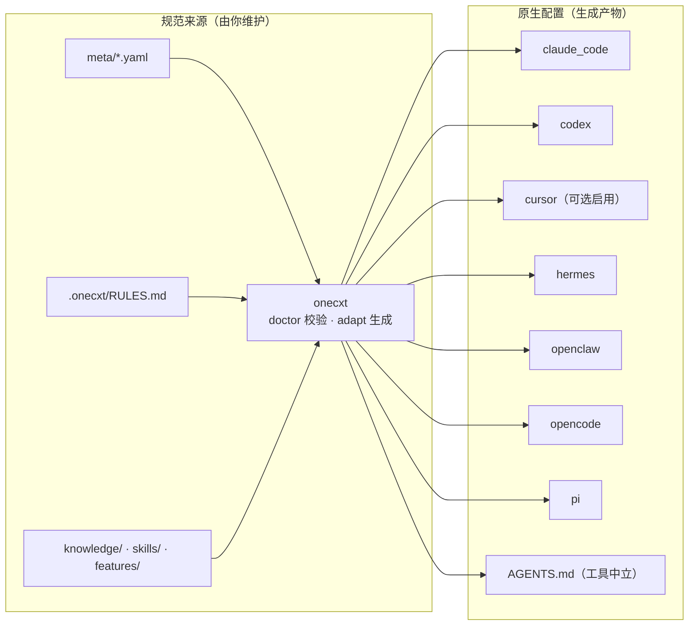

<p align="center">
  
</p>

<div align="center">

# one-context

**共享上下文，原生工具格式。**

多仓库 AI 工作区的单一事实来源 ——
一条命令生成各工具的原生配置。

[`快速开始`](#快速开始) · [`工作原理`](#工作原理) · [`文档`](docs/getting-started.md) · [English](README.md)

[](https://github.com/harnessworld/one-context-opensource/actions/workflows/validate.yml)
[](LICENSE)
[](https://www.python.org/)

`beta` —— 1.0 之前 · 状态：[见下文](#项目状态)

</div>

---

## one-context 是什么？

每个 AI 编码工具都需要项目上下文，但格式各不相同：`CLAUDE.md`、
`AGENTS.md`、`.cursor/rules/*.mdc`、`.opencode/instructions/`、
`.codex/agents/*.toml`……在多个工具间手工维护同一份意图，很快就会演变成
复制粘贴、各自漂移。

**工作区只定义一次。** 你只维护一份工作区意图 ——
仓库、工作区、智能体角色、行为画像、规则、知识与技能 —— 用普通的 YAML
与 Markdown 书写；然后一条命令生成所有工具的原生配置：

```bash
onecxt adapt dev
```

- **共享上下文** —— `meta/*.yaml` 清单，加上 `.onecxt/RULES.md`、
  `knowledge/`、`skills/`、`features/`，就是你唯一需要维护的文件。
- **原生工具** —— 适配器把共享意图翻译成各工具自己的格式：指令、智能体、
  技能与项目文件。
- **受保护的生成产物** —— 生成文件带有标记；`adapt` 拒绝覆盖手工修改，
  `adapt --check` 检测漂移，孤儿产物被确定性地清理。
- **工作区工具** —— `doctor` 校验整个关系图，`sync` 管理仓库克隆，
  `context export` 输出工具中立的上下文包，`worktree` 驱动特性工作树，
  `smart-commit` 在多仓提交前设置显式安全门槛。

## 支持的工具（适配器）

`onecxt adapt` 自动发现 **七个**适配器，key 为：

`claude_code` · `codex` · `cursor` · `hermes` · `openclaw` · `opencode` · `pi`

`cursor` 默认**不启用**（`onecxt adapt dev --only cursor` 显式启用），
因为 Cursor 的常开规则会让每次对话都膨胀；其余适配器默认生成。生成流程还会为需要它的工具产出共享根级 `AGENTS.md`；每次运行的兼容矩阵
记录在 `adapt-report.json` 中。

> 适配器层仍在 beta：工具生态变化很快，请把生成产物当作构建输出、放心地
> 重新生成，预期以[文档](docs/architecture.md)为准。

## 快速开始

全新克隆即可运行 —— 无子模块、无外部仓库依赖。需要 **Python 3.10+**；
完整步骤（含 Windows）见[上手指南](docs/getting-started.md)。

```bash
git clone https://github.com/harnessworld/one-context-opensource.git one-context
cd one-context

# 1. 虚拟环境（此处为 POSIX；Windows：py -m venv .venv + Activate.ps1）
python3 -m venv .venv && source .venv/bin/activate
python -m pip install --upgrade pip

# 2. 安装 CLI（可编辑模式）
python -m pip install -e "./packages/one-context[dev]"
onecxt --version

# 3. 校验示例工作区
onecxt doctor

# 4. 为六个适配器 + 根 AGENTS.md 生成工具配置
onecxt adapt dev

# 5. （可选）按需生成 Cursor 配置
onecxt adapt dev --only cursor

# 6. 导出工具中立的上下文包
onecxt context export dev --format markdown

```

随后替换成你自己的内容：在 `meta/repos.yaml` 注册仓库（`onecxt sync`
克隆），把知识放进 `knowledge/`，复制 `features/_template/` 开始第一个
特性，并在 `skills/<name>/SKILL.md` 添加技能。

## 工作原理



规则以"急加载"方式内联进每个目标；技能以"懒加载"方式发布为指向规范
`SKILL.md` 的各工具桩文件。模块地图与完整适配器矩阵见
[`docs/architecture.md`](docs/architecture.md)，主要清单字段见
[`docs/configuration.md`](docs/configuration.md)。

## 仓库布局

| 路径 | 内容 | 归属 |
|---|---|---|
| `packages/one-context/` | `one_context` 包 + `onecxt` CLI + 测试 | 框架 |
| `meta/` | repos · workspaces · agents · profiles 清单（示例） | 你 |
| `.onecxt/RULES.md` | 唯一约束面，内联进所有工具 | 你 |
| `knowledge/01_Compiled/one-context/` | 规范总览 + 约定（示例） | 你 |
| `skills/workspace-review/` | 只读示例技能（示例） | 你 |
| `features/_template/` + `INDEX.md` | 规格驱动的变更流（示例） | 你 |
| `docs/` | 上手指南 · 架构 · 配置参考 | 框架 |
| `docs/assets/` | 仅含原创矢量图；无生成媒体 | 框架 |

## 所有权边界与隐私限制

- **手写事实源 vs 生成的构建产物。** 只有上述规范来源供人编辑；任何带有
  `GENERATED by onecxt adapt` 标记的文件 —— 包括 `AGENTS.md`、
  `CLAUDE.md` 和各工具目录 —— 都由它们重新生成。根级 `AGENTS.md`
  随仓库提供，其他工具配置默认被 Git 忽略。
- **内容始终属于你。** `knowledge/`、`skills/`、`features/` 都是普通的
  目录，装着全新编写的示例；你可以替换或扩展它们，也可以之后换成自己的
  独立子模块 —— 本仓库对这些目录没有任何内置假设。
- **隐私是过滤器，不是加密。** 带 `visibility: private` frontmatter 的
  Markdown 笔记会被排除在上下文导出与适配器投影之外 —— 但文件仍在磁盘上
  可读，一旦提交也进入 git 历史。真正敏感的材料请放在不入库的路径里。
- **机器配置留在本地。** 机器级设置（`.onecxt/local.yaml`、`.env*`）
  被 git 忽略；共享清单中不含代理路由、服务商端点或个人路径。

## 文档

- [上手指南](docs/getting-started.md) —— 克隆 → 安装 → doctor → adapt →
  export，以及如何加入自己的仓库/知识/特性/技能
- [架构](docs/architecture.md) —— 模块地图、生成流水线、适配器矩阵
- [配置参考](docs/configuration.md) —— 清单 schema 与生成产物
- [变更日志](CHANGELOG.md) —— Unreleased 条目；尚无发布版本

## 贡献与安全

- 请先阅读 [CONTRIBUTING.md](CONTRIBUTING.md) —— 仅接受框架通用改动；
  私有工作区内容不属于这里。
- 漏洞：**不要**开公开 issue；见 [SECURITY.md](SECURITY.md)。

## 项目状态

- **Beta。** 0.x 版本间清单格式仍可能变化；由[变更日志](CHANGELOG.md)记录。
- CI 已配置为在 Linux、macOS、Windows 上运行 Python 3.12（Linux 另含
  Python 3.10），执行包测试、`onecxt doctor`、`onecxt adapt dev` 与
  `adapt --check`；最新运行结果见上方徽章。
- 核心工作区操作在本地运行；仓库同步访问 Git 远端，可选的技能评测
  会调用你配置的模型服务。

## 许可证

MIT —— 见 [LICENSE](LICENSE)。
