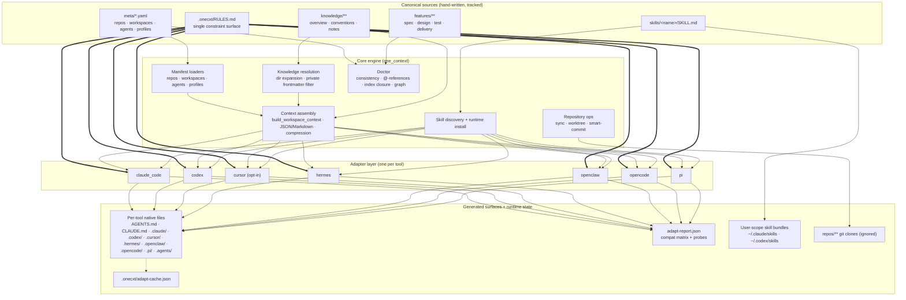

# Architecture

one-context is a Python CLI (`onecxt`, package `one_context`) that turns a
small set of canonical sources into every supported AI tool's native
configuration. This document is derived from the source tree under
[`packages/one-context/one_context/`](../packages/one-context/one_context/).

## Big picture



Key properties:

- **Rules are eager, skills are lazy.** `.onecxt/RULES.md` is inlined
  verbatim into every adapter's startup context; skills are published as
  per-tool stubs that point back to `skills/<name>/SKILL.md`.
- **Generation protects hand edits by default.** Emitted files carry a
  `GENERATED` marker; `adapt` refuses to overwrite files without it unless
  `--force` is given, and `adapt --check` classifies surfaces as
  `missing` / `stale` / `user_edited`.
- **Repository paths are bounded.** Repository and worktree path validation
  keeps those outputs within the workspace root; review knowledge references
  before adding them to a shared workspace.

## Core modules

| Module | Responsibility |
|---|---|
| `root.py` | Root discovery: `ONECXT_ROOT`, `--root`, or walking parents until `meta/repos.yaml` or `meta/agents.yaml` is found |
| `repos.py` · `workspaces.py` · `agents.py` · `profiles.py` | Manifest parsing, id normalization, reference checks |
| `_knowledge.py` | Expands directory knowledge entries; skips files with `visibility: private` frontmatter |
| `context/` | Tool-neutral workspace context: JSON/Markdown renderers plus approximate token-budget compression |
| `validate.py` | `doctor`: cross-manifest consistency, knowledge integrity, `@`-reference scan, feature index closure, rules presence, git `insteadOf` loop detection; also `--graph` Mermaid knowledge graph |
| `sync.py` · `worktree.py` | Clone/fast-forward registry repos; per-feature git worktrees driven by the dev agent's patterns |
| `deploy.py` | Per-repo `deploy.yaml` schema (strategy, stages, health checks, rollback) |
| `smart_commit.py` | Plan-then-execute multi-repo commit/push with safety gates (classification, sensitive scan, plan id pinning) |
| `skills.py` | `skills/<name>/SKILL.md` discovery/parsing; user-scope install to `~/.claude/skills` / `~/.codex/skills` with secret filters |
| `cache.py` | SHA-256 cache for incremental `adapt` runs (`.onecxt/adapt-cache.json`) |
| `project_artifacts.py` | Tool-neutral root `AGENTS.md` from the canonical overview + rules |
| `adapters/` | One module per tool plus shared helpers (`_rules`, `_rules_ref`, `_shared_rules`, `_agent_skills`, `_report`) |
| `eval_lite/` · `cli/_syseval.py` | Experimental skill evaluation harness (`onecxt eval`), off by default in CI |

## Adapter matrix

Every adapter implements up to four generation phases: workspace
instructions, per-agent artifacts, skill registration, and project
artifacts. Generated paths are fixed so pruning can be safe and
deterministic.

| Adapter key | Workspace surface | Agents | Skills | Project artifacts | Notes |
|---|---|---|---|---|---|
| `claude_code` | `.claude/adapters/onecxt-<ws>.md` | `.claude/agents/<id>.md` | `.claude/skills/<name>/SKILL.md` | `CLAUDE.md` | Follows `@file` references at runtime |
| `codex` | `.codex/instructions/onecxt-<ws>.md` | `.codex/agents/<id>.toml` | shared `.agents/skills/<name>/SKILL.md` | `.codex/README.md` | Consumes root `AGENTS.md`; does not distribute slash commands |
| `cursor` | `.cursor/rules/onecxt-<ws>.mdc` | `.cursor/rules/agent-<id>.mdc` | `.cursor/rules/skill-<name>.mdc` | `.cursor/rules/onecxt-hard-rules.mdc` | **Opt-in:** skipped by default, emit with `--only cursor` |
| `hermes` | `.hermes/onecxt-<ws>.md` | `.hermes/agents/<id>.md` | `.hermes/skills/<name>.md` | `.hermes.md` | |
| `openclaw` | `.openclaw/onecxt-<ws>.json` | — | — | `.openclaw/onecxt-project.json` | Tool ignores project-local agents/skills; declared explicitly |
| `opencode` | `.opencode/instructions/onecxt-<ws>.md` | `.opencode/agent/<id>.md` | `.opencode/skills/<name>/SKILL.md` | `.opencode/opencode.json` | Consumes root `AGENTS.md`; does not distribute slash commands |
| `pi` | aggregated into `.pi/APPEND_SYSTEM.md` | `.pi/prompts/agent-<id>.md` | shared `.agents/skills/<name>/SKILL.md` (+ optional `/<alias>` prompts) | `.pi/APPEND_SYSTEM.md` | Consumes root `AGENTS.md` |

Cross-cutting outputs emitted once per run when at least one consuming
adapter is active:

- `AGENTS.md` — tool-neutral guide built from
  `knowledge/01_Compiled/one-context/project-overview.md` plus the full
  rules body (consumers: `codex`, `opencode`, `pi`).
- Shared Agent Skills surface `.agents/skills/<name>/SKILL.md` (consumers:
  `codex`, `pi`).
- `adapt-report.json` — per-asset compatibility matrix with disk status
  (`written` / `cached` / `skipped_user_edited`) and best-effort CLI
  version probes.

## Generation pipeline (`onecxt adapt`)

```mermaid
sequenceDiagram
    participant U as User
    participant C as onecxt adapt
    participant M as Manifests
    participant A as Adapters
    participant D as Disk

    U->>C: onecxt adapt dev [--only pi|--check|--dry-run]
    C->>M: load workspaces · agents · profiles · skills
    M-->>C: validated entries
    C->>C: build workspace context (knowledge expansion, private filter)
    loop each adapter
        C->>A: generate(workspace) / generate_agents / generate_skills / project artifacts
        A-->>C: GeneratedFile set (rel_path, content, metadata)
    end
    C->>C: duplicate/unsafe-path checks; rules block inlining
    alt --check
        C->>D: compare disk vs generated (missing / stale / user_edited)
    else write run
        C->>D: write files (skip USER_EDITED without --force; cache skips no-op writes)
        C->>D: save .onecxt/adapt-cache.json and adapt-report.json
        C->>D: prune orphans (deleted skills/agents → generated files only)
    end
    C-->>U: summary: written / cached / skipped / pruned
```

## Privacy and ownership boundaries

- Private knowledge is a **collection filter**: files with
  `visibility: private` frontmatter are excluded from context exports and
  adapter projections (knowledge expansion into generated instructions).
  It is not access control — the files remain on disk and in git history
  if committed.
- Generated files are build artifacts. Canonical truth lives only in
  `meta/*.yaml`, `.onecxt/RULES.md`, `knowledge/01_Compiled/**`,
  `features/`, and `skills/<name>/SKILL.md`.
- Runtime skills installed to user scope never copy hidden, cache-like, or
  suspiciously named files; secret patterns are filtered at install time.
